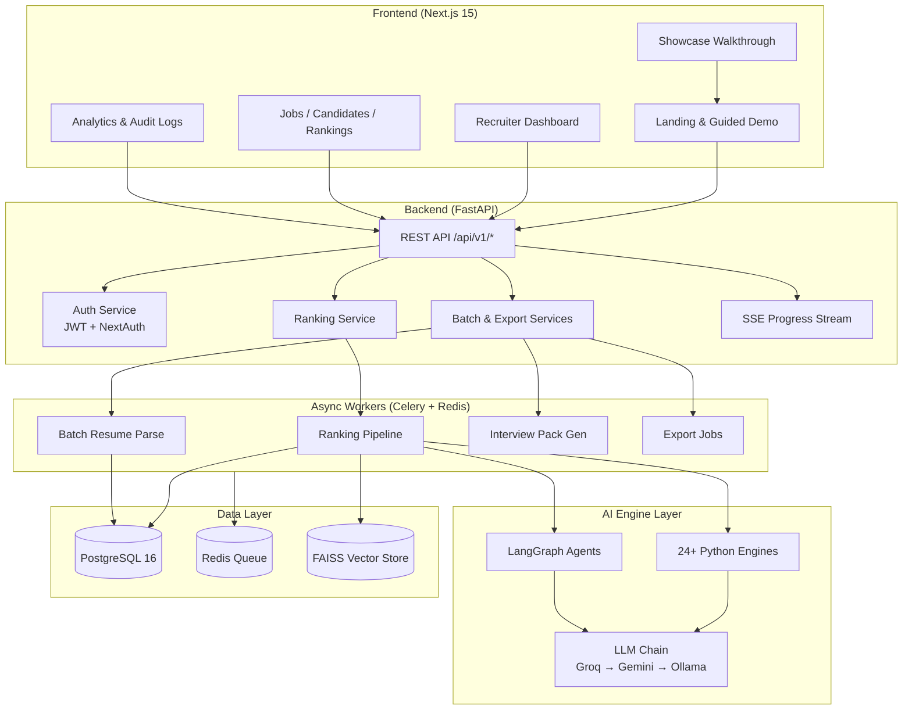
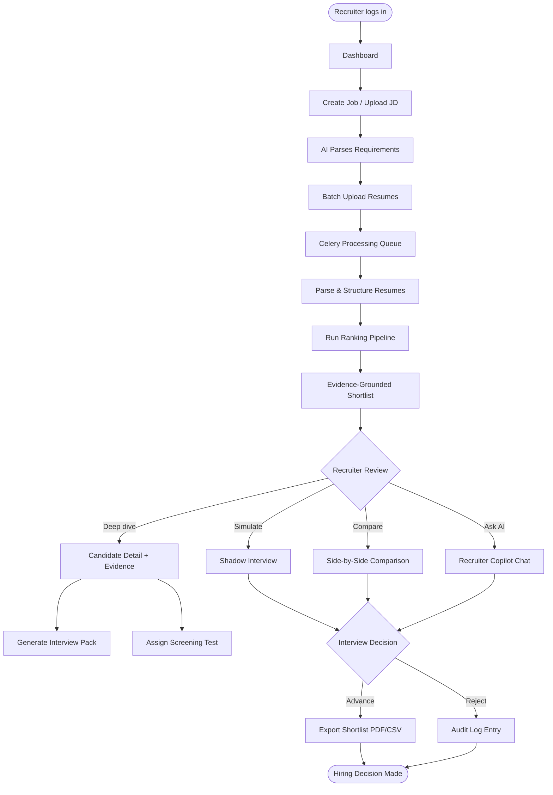
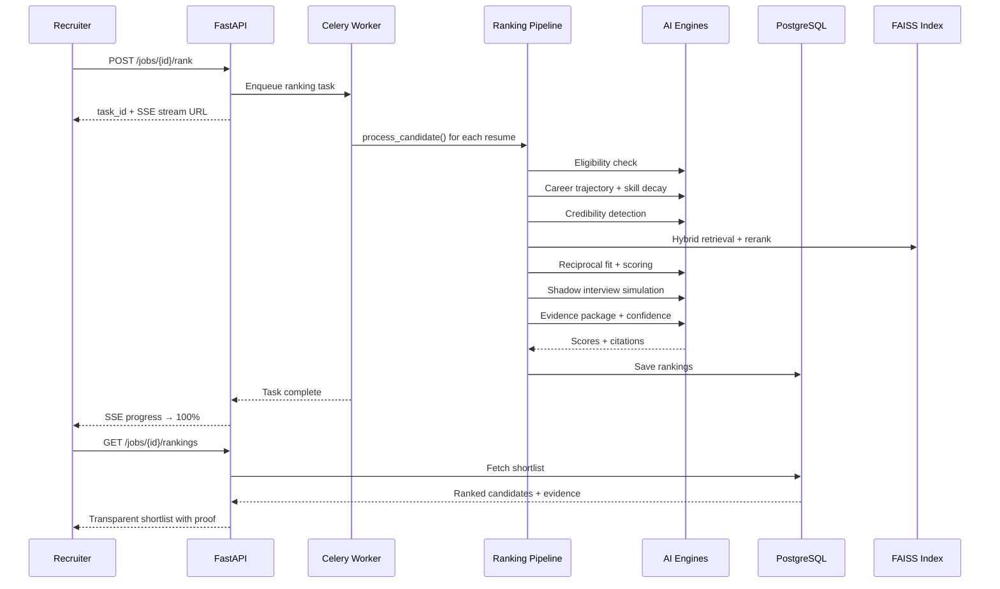

# Smart Resume Shortlister-A

> **A Website Helpful for Recruiters — Hire Smarter with Evidence-Grounded AI**

An AI-powered recruitment intelligence platform that goes beyond keyword matching to deliver **explainable, evidence-grounded candidate shortlists**. Parse job descriptions, analyze hundreds of resumes, rank candidates with 24+ AI engines, simulate shadow interviews, and export transparent hiring reports — all in one recruiter-friendly dashboard.

**Developed by [Pawani Sharma](https://github.com/pawani-2502)**

---

## Table of Contents

- [Problem Statement](#problem-statement)
- [Solution](#solution)
- [Key Features](#key-features)
- [System Architecture](#system-architecture)
- [Recruiter Workflow](#recruiter-workflow)
- [Ranking Pipeline Flow](#ranking-pipeline-flow)
- [Tech Stack](#tech-stack)
- [Project Structure](#project-structure)
- [AI Engines](#ai-engines)
- [API Reference](#api-reference)
- [Recruiter UI Pages](#recruiter-ui-pages)
- [Getting Started](#getting-started)
- [Environment Variables](#environment-variables)
- [Docker Deployment](#docker-deployment)
- [Testing](#testing)
- [Screenshots](#screenshots)
- [Future Roadmap](#future-roadmap)
- [Contributing](#contributing)
- [License](#license)
- [Author](#author)

---

## Problem Statement

Recruiters face a crushing volume of resumes and tools that barely help:

- **ATS keyword filters** miss strong candidates who don't mirror JD wording
- **No explainability** — recruiters can't defend why someone ranked #3 vs #8
- **Manual screening** eats hours per role with inconsistent outcomes
- **Hidden bias** creeps into hiring without audit trails
- **Interview waste** — weak fits reach live calls because pre-screening is shallow
- **Scattered workflows** — JD parsing, resume review, comparison, and export live in different tools

**Smart Resume Shortlister-A** gives recruiters one platform to shortlist faster, explain every score, and hire with confidence.

---

## Solution

Smart Resume Shortlister-A is an **AI Recruitment Intelligence Platform** that:

1. **Parses job descriptions** from PDF, DOCX, or text — extracting requirements and hidden signals
2. **Extracts structured data** from resumes at scale (batch upload of hundreds)
3. **Ranks candidates** using 24+ AI engines — hybrid retrieval, cross-encoder reranking, career trajectory, skill decay, and more
4. **Grounds every score in evidence** — each claim cites resume snippets recruiters can verify
5. **Simulates shadow interviews** before real calls — multi-agent Q&A with readiness scoring
6. **Generates screening tests & interview packs** tailored to each candidate's gaps
7. **Provides a Recruiter AI Copilot** — ask "Who should I interview first?" with RAG-backed answers
8. **Exports shortlists** to PDF, CSV, Excel, and JSON

---

## Key Features

### Core Screening (Phase 1)

| Feature | Description |
|---------|-------------|
| **JD Intelligence** | Parse PDF/DOCX/text job descriptions; extract requirements and ideal candidate profile |
| **Resume Intelligence** | Structured extraction from PDF/DOCX/TXT resumes |
| **Hybrid Retrieval** | BM25 + dense embeddings (sentence-transformers) + FAISS per-job indices |
| **Cross-Encoder Reranking** | ms-marco-MiniLM for semantic precision |
| **Career Trajectory Analysis** | Promotion velocity, growth, and stability scores |
| **Temporal Skill Decay** | Recency-adjusted skill scoring |
| **Latent Skill Graph** | Ontology-based skill inference and coverage |
| **Reciprocal Fit Engine** | Bidirectional candidate ↔ role fit scoring |
| **Eligibility Gate** | Knockout filters with explicit rejection reasons |
| **Credibility Detection** | Resume inflation and timeline consistency checks |
| **Scoring Engine** | Configurable weighted final scores |
| **Evidence Grounding** | Every ranking claim cites resume snippets |
| **Confidence & Human Review** | Automated flagging for low-confidence decisions |
| **Batch Processing** | Async upload and ranking of hundreds of resumes |
| **Export** | PDF, CSV, Excel, JSON shortlist exports |

### Advanced Intelligence (Phase 2–4)

| Feature | Description |
|---------|-------------|
| **Shadow Interview System** | Multi-agent simulation with evidence-only answers |
| **Screening Tests** | Auto-generated skill verification assessments |
| **Interview Packs** | Gap-focused technical and behavioral question kits |
| **Bias Audit** | Blind vs identified scoring comparison |
| **Candidate Comparison** | Side-by-side evaluation of up to 10 candidates |
| **Recruiter AI Copilot** | RAG chat for hiring questions |
| **Knowledge Graph** | Candidate skill and experience relationship graph |
| **JD Quality Analyzer** | Inclusivity and completeness scoring |
| **Multi-Job Fit Analysis** | Cross-role candidate matching |
| **Feedback Learning** | Weight suggestions from hiring outcomes |
| **Audit Trail** | Immutable recruitment event log |
| **Resume Deduplication** | Exact and fuzzy duplicate detection |

---

## System Architecture



---

## Recruiter Workflow



---

## Ranking Pipeline Flow



---

## Tech Stack

| Layer | Technologies |
|-------|-------------|
| **Frontend** | Next.js 15, TypeScript, Tailwind CSS, ShadCN UI, React Query, Recharts, NextAuth |
| **Backend** | FastAPI, Python 3.11, SQLAlchemy, Pydantic, Celery |
| **Database** | PostgreSQL 16 |
| **Queue / Cache** | Redis + Celery async workers |
| **Vector Store** | FAISS (per-job indices) |
| **AI / ML** | LangGraph agents, sentence-transformers, HuggingFace cross-encoder |
| **LLM** | Groq → Gemini → Ollama fallback chain |
| **Auth** | JWT + NextAuth (credentials + Google OAuth) |
| **DevOps** | Docker Compose, Vercel, Railway/Render ready |

---

## Project Structure

```
SMART-RESUME-SHORTLISTER-A/
├── frontend/              # Next.js 15 recruiter dashboard
│   └── src/app/           # App router pages (jobs, rankings, analytics, …)
├── backend/               # FastAPI REST API
│   ├── api/               # Route handlers
│   ├── services/          # Business logic
│   ├── workers/           # Celery task definitions
│   └── models.py          # SQLAlchemy models
├── ai/
│   ├── agents/            # LangGraph orchestrators (copilot, shadow interview)
│   ├── engines/           # 24+ AI modules (scoring, retrieval, bias, …)
│   ├── pipeline/          # Ranking orchestration
│   └── prompts/           # Versioned LLM prompt templates
├── showcase/              # Guided demo walkthrough engine
├── database/              # PostgreSQL schema
├── docker/                # Dockerfiles + docker-compose.yml
├── tests/                 # Unit + integration tests
├── scripts/               # Seed demo data + DB setup
├── docs/                  # Sample JDs and resumes
└── deployment/            # Platform-specific configs
```

---

## AI Engines

| Engine | Purpose |
|--------|---------|
| `hybrid_retrieval` | BM25 + dense embeddings + FAISS vector search |
| `cross_encoder` | ms-marco-MiniLM semantic reranking |
| `career_trajectory` | Promotion velocity, growth, stability analysis |
| `skill_decay` | Recency-adjusted skill freshness scoring |
| `skill_graph` | Ontology-based latent skill inference |
| `reciprocal_fit` | Bidirectional candidate ↔ role fit |
| `eligibility` | Knockout filters with explicit reasons |
| `credibility` | Resume inflation and timeline checks |
| `scoring` | Configurable weighted final score computation |
| `evidence` | Citation-backed explanation packages |
| `confidence` | Human-review flagging for uncertain scores |
| `shadow_interview` | Multi-agent interview simulation |
| `screening` | Auto-generated skill verification tests |
| `bias_audit` | Blind vs identified scoring comparison |
| `comparison` | Side-by-side multi-candidate evaluation |
| `knowledge_graph` | Candidate skill/experience graph builder |
| `jd_quality` | JD inclusivity and completeness analyzer |
| `multi_job_fit` | Cross-role candidate matching |
| `feedback_learning` | Weight tuning from hiring outcomes |
| `candidate_improvement` | Actionable resume improvement reports |

---

## API Reference

| Method | Endpoint | Description |
|--------|----------|-------------|
| `POST` | `/api/v1/auth/register` | Create recruiter account |
| `POST` | `/api/v1/auth/login` | Sign in (JWT) |
| `GET` | `/api/v1/auth/me` | Current user profile |
| `POST` | `/api/v1/jobs` | Create job from text |
| `POST` | `/api/v1/jobs/upload` | Upload JD file (PDF/DOCX) |
| `GET` | `/api/v1/jobs/{id}` | Get job details + parsed requirements |
| `POST` | `/api/v1/candidates/job/{id}/batch` | Batch resume upload |
| `POST` | `/api/v1/jobs/{id}/rank` | Run ranking pipeline (async) |
| `GET` | `/api/v1/jobs/{id}/rankings` | Get evidence-grounded shortlist |
| `POST` | `/api/v1/jobs/{id}/compare` | Compare up to 10 candidates |
| `POST` | `/api/v1/jobs/{id}/copilot/chat` | Recruiter AI copilot |
| `POST` | `/api/v1/jobs/{id}/export` | Export shortlist (PDF/CSV/Excel/JSON) |
| `GET` | `/api/v1/progress/{task_id}/stream` | SSE real-time task progress |
| `GET` | `/api/v1/analytics` | Hiring funnel and score analytics |
| `GET` | `/api/v1/audit` | Immutable audit event log |

Full interactive docs at **http://localhost:8000/docs** (Swagger UI).

---

## Recruiter UI Pages

| Page | Path | Description |
|------|------|-------------|
| Landing | `/` | Product overview + guided demo entry |
| Dashboard | `/dashboard` | Recruiter home with active jobs |
| Jobs | `/jobs` | Job list and creation |
| Job Detail | `/jobs/[id]` | JD requirements, candidates, run ranking |
| Rankings | `/rankings` | Shortlist with score breakdowns |
| Candidate Detail | `/candidates/[id]` | Evidence viewer, knowledge graph |
| Comparison | `/comparison` | Side-by-side candidate evaluation |
| Analytics | `/analytics` | Hiring funnel, score distribution |
| Copilot | `/copilot` | AI chat for hiring questions |
| Screening Tests | `/jobs/[id]/screening` | Manage skill verification tests |
| Take Test | `/tests/[id]/take` | Candidate assessment page |
| Interview Pack | `/jobs/[id]/candidates/[cid]/interview-pack` | Tailored question kit |
| JD Quality | `/jobs/[id]/jd-quality` | JD inclusivity dashboard |
| Multi-Job Fit | `/candidates/[id]/multi-job-fit` | Cross-role matching |
| Ranking History | `/jobs/[id]/ranking-history` | Historical ranking runs |
| Audit Logs | `/audit` | Immutable event trail |
| Guided Demo | `/demo` | Interactive product walkthrough |

**Demo login:** `admin@shortlister.ai` / `admin123`

---

## Getting Started

### Prerequisites

- **Docker & Docker Compose**
- **Node.js** 20+
- **Python** 3.11+

### Quick Start

**1. Clone the repository**

```bash
git clone https://github.com/pawani-2502/SMART-RESUME-SHORTLISTER-A.git
cd SMART-RESUME-SHORTLISTER-A
```

**2. Configure environment**

```bash
cp .env.example .env
# Optional: set GROQ_API_KEY or GEMINI_API_KEY for enhanced LLM parsing
```

**3. Start infrastructure**

```bash
cd docker
docker compose up -d postgres redis
```

**4. Backend + Celery worker**

```bash
pip install -r backend/requirements.txt
python scripts/seed_demo.py
uvicorn backend.main:app --reload --host 0.0.0.0 --port 8000

# Separate terminal — background jobs
celery -A backend.celery_app worker --loglevel=info
```

**5. Frontend**

```bash
cd frontend
npm install
npm run dev
```

| Service | URL |
|---------|-----|
| Frontend | http://localhost:3000 |
| API Docs | http://localhost:8000/docs |
| Guided Demo | http://localhost:3000/demo?mode=examiner |

### Demo Workflow

1. **Login** with `admin@shortlister.ai` / `admin123`
2. Open **Jobs** → "Senior Full Stack Engineer (Demo)"
3. View parsed JD requirements and 3 pre-seeded candidates
4. Click **Run Ranking** to generate evidence-grounded shortlist
5. Explore **Rankings** with score breakdowns and export
6. Open **Candidate Detail** → Evidence Viewer, Knowledge Graph
7. Run **Shadow Interview** simulation
8. Ask the **AI Copilot**: "Who should I interview first?"
9. **Compare** candidates side-by-side

---

## Environment Variables

| Variable | Required | Description |
|----------|----------|-------------|
| `DATABASE_URL` | **Yes** | PostgreSQL connection string |
| `REDIS_URL` | **Yes** | Redis URL for Celery queue |
| `JWT_SECRET` | **Yes** | Secret for JWT token signing |
| `GROQ_API_KEY` | No | Groq LLM provider (primary) |
| `GEMINI_API_KEY` | No | Google Gemini LLM (fallback) |
| `EMBEDDING_MODEL` | No | sentence-transformers model name |
| `NEXT_PUBLIC_API_URL` | **Yes** | Frontend → backend API URL |
| `GOOGLE_CLIENT_ID` | No | Google OAuth client ID |
| `GOOGLE_CLIENT_SECRET` | No | Google OAuth client secret |
| `NEXTAUTH_SECRET` | **Yes** | NextAuth session secret |

See `.env.example` for the complete list.

---

## Docker Deployment

Run the full stack with one command:

```bash
cd docker
docker compose up --build
```

| Platform | Component |
|----------|-----------|
| **Vercel** | Frontend (`frontend/`) |
| **Railway / Render** | Backend API + Celery workers |
| **DigitalOcean** | App Platform or Droplets |
| **Docker** | Full stack via `docker/docker-compose.yml` |

See `deployment/` for platform-specific configuration files.

---

## Testing

```bash
# Unit tests (no database required for engine tests)
pytest tests/unit -v

# Integration tests (requires PostgreSQL)
pytest tests/integration -v
```

---

## Screenshots

| Rankings Dashboard | Shadow Interview | Analytics Hub |
|:---:|:---:|:---:|
| _AI-ranked shortlist with evidence_ | _Simulated interview scoring_ | _Hiring funnel & heatmaps_ |

| Candidate Comparison | Screening Tests | Interview Packs |
|:---:|:---:|:---:|
| _Side-by-side evaluation_ | _Auto-generated assessments_ | _Tailored question kits_ |

---

## Future Roadmap

- [ ] ATS integrations (Greenhouse, Lever, Workday)
- [ ] Enterprise SSO (SAML, OIDC)
- [ ] Predictive hiring analytics
- [ ] Video interview AI analysis
- [ ] Feedback learning from hiring outcomes
- [ ] Multi-tenant organization support
- [ ] Mobile recruiter app
- [ ] Custom scoring weight templates per role

---

## Contributing

Contributions are welcome! To contribute:

1. Fork the repository
2. Create a feature branch: `git checkout -b feature/your-feature`
3. Commit your changes: `git commit -m "Add your feature"`
4. Push to the branch: `git push origin feature/your-feature`
5. Open a Pull Request

Please run `pytest tests/unit -v` before submitting.

---

## License

Proprietary — Smart Resume Shortlister-A © 2026. All rights reserved.

---

## Author

**Pawani Sharma**

B.Tech CSE · SRM Institute of Science and Technology, Chennai. Passionate about Artificial Intelligence, Explainable AI, and building intelligent systems that help recruiters hire better.

- GitHub: [@pawani-2502](https://github.com/pawani-2502)

---

<p align="center">
  <strong>Smart Resume Shortlister-A</strong> — A website helpful for recruiters. Hire smarter with evidence-grounded AI.
  <br />
  Built with 🧠 by <a href="https://github.com/pawani-2502">Pawani Sharma</a>
</p>
